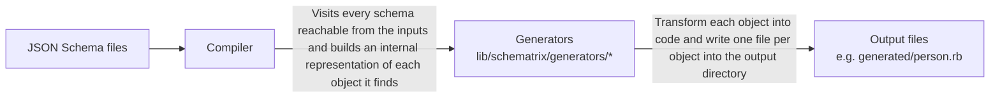

# schematrix

> Generate Ruby code and RBS signatures from JSON Schema definitions.

`schematrix` is a Ruby gem and CLI tool that reads [JSON Schema](https://json-schema.org/) files and produces idiomatic Ruby source code. Point it at a schema, choose a generator, and get ready-to-use Ruby classes and type signatures written into your project.

Four output formats share one compiler: plain Ruby classes, Ruby classes with inline Sorbet signatures, Sorbet RBI files, and RBS signature files.

---

## Requirements

- Ruby **≥ 3.4**
- Bundler (for gem installation)

---

## Installation

Add `schematrix` to your `Gemfile`:

```ruby
gem 'schematrix', '~> 0.1'
```

Then run:

```sh
bundle install
```

Or install it directly:

```sh
gem install schematrix
```

---

## Quick Start

Given this JSON Schema (`person.schema.json`):

```json
{
  "$schema": "https://json-schema.org/draft/2020-12/schema",
  "title": "Person",
  "type": "object",
  "properties": {
    "firstName": { "type": "string" },
    "lastName":  { "type": "string" },
    "age":       { "type": "integer" }
  },
  "required": ["firstName", "lastName"]
}
```

Run:

```sh
schematrix -g plain_ruby -m MyApp -o app/generated person.schema.json
```

This produces `app/generated/person.rb`:

```ruby
# DO NOT EDIT MANUALLY
# This is an autogenerated file for the MyApp::Person class.
# Please instead update this file by running `schematrix`.

module MyApp
  class Person
    ORIGINAL_KEYS = {
      "firstName" => :first_name,
      "lastName" => :last_name,
      "age" => :age
    }.freeze

    def initialize(first_name:, last_name:, age: nil)
      @first_name = first_name
      @last_name = last_name
      @age = age

      @_extra = {}
    end

    attr_accessor :first_name, :last_name, :age

    def [](key)
      @_extra[key]
    end

    def []=(key, value)
      @_extra[key] = value
    end

    def self.from_h(hash)
      instance =
        new(
          first_name: hash["firstName"],
          last_name: hash["lastName"],
          age: hash["age"]
        )

      hash.each do |key, value|
        next if ORIGINAL_KEYS.key?(key)

        instance[key] = value
      end
      instance
    end

    def to_h
      result = {}
      result["firstName"] = @first_name unless @first_name.nil?
      result["lastName"] = @last_name unless @last_name.nil?
      result["age"] = @age unless @age.nil?
      @_extra.each { |key, value| result[key] = value }
      result
    end
  end
end
```

Every generated class carries `ORIGINAL_KEYS`, the map from the
schema's property names to the generated accessor symbols, plus a
`from_h`/`to_h` pair that loads and dumps documents under those
original names: nested object schemas load through their own
`from_h`, unknown keys ride the catch-all (`[]`/`[]=`) with their
original String keys, and absent keys keep their constructor
defaults. See the [generated code guide](docs/generated-code.md).

Schema documents in YAML work the same way; JSON is a subset of YAML
and both load.

---

## CLI Reference

```text
Usage: schematrix [OPTIONS] INPUT [INPUT...]

Generate code matching a JSON Schema

Options:
      --closed-shapes      Treat absent additionalProperties as false: closed
                           classes with no catch-all, instead of the spec
                           default
  -g, --generators list    Output generators to use, e.g.: plain_ruby, rbs
  -h, --help               Print usage
  -m, --module string      Module where the output code will be placed
  -o, --output string      Directory where the output will be written
      --schema-dir string  Directory where remote schema URIs resolve to local
                           files; may be given multiple times, defaults to
                           vendor/schemas
  -v, --verbose            Each additional occurrence lowers logger level,
                           -vvv for the minimum

Examples:
  Produce plain Ruby code for the given schema
    $ schematrix -g plain_ruby -m MyModule -o /output/dir my-json-schema.json
```

The options list above mirrors `schematrix --help`. The full option
reference, including output directory pairing and exit behavior, lives
in the [command line manual](docs/cli.md).

### Example usages

Generate plain Ruby classes for a single schema:

```sh
schematrix -g plain_ruby -m MyApp -o app/generated schema.json
```

Process multiple schemas at once:

```sh
schematrix -g rbs -m Contracts user.schema.json order.schema.json
```

Or even:

```sh
schematrix -g plain_ruby -m Contracts *.schema.json
```

You might specify different output directories for different generators like so:

```sh
schematrix -g plain_ruby -o generated -g rbi -o rbi *.schema.json
```

### Resolving remote schemas

`schematrix` never fetches anything over the network. When a schema
references another schema through an `http(s)` URI, that URI must resolve
to a local file through a schema directory. By default the tool searches
`vendor/schemas` in the current directory; pass `--schema-dir` to point
somewhere else:

```sh
schematrix -g plain_ruby -m MyApp --schema-dir local/schemas schema.json
```

The option may be given multiple times; the directories are searched in
order, and explicit directories replace the default rather than adding
to it.

The directory mirrors the URI structure: host, then path. The URI

```text
https://json-schema.org/draft/2020-12/meta/core
```

resolves to the first existing file among

```text
vendor/schemas/json-schema.org/draft/2020-12/meta/core
vendor/schemas/json-schema.org/draft/2020-12/meta/core.json
vendor/schemas/json-schema.org/draft/2020-12/meta/core.yaml
vendor/schemas/json-schema.org/draft/2020-12/meta/core.yml
```

Directories given more than once are searched in order, and the first
matching file wins. A remote URI with no matching local file is an error
listing every candidate path. The 2020-12 JSON Schema meta files are
vendored in this repository under `vendor/schemas`, so schemas referencing
`https://json-schema.org/draft/2020-12/...` resolve out of the box when
running from the repository root.

---

## Generators

All four generators walk the same compiled records and write one file
per object schema. They differ only in notation:

| Name          | Writes                                                          |
| ------------- | --------------------------------------------------------------- |
| `plain_ruby`  | Mutable Ruby classes, no annotations                            |
| `sorbet_ruby` | Mutable Ruby classes with inline Sorbet `sig` blocks            |
| `rbi`         | Sorbet signature files: signatures only, empty bodies           |
| `rbs`         | RBS signature files                                             |

See the [generator guide](docs/generators.md) for sample output and the
type mapping tables per notation.

### `plain_ruby`

Produces mutable Ruby classes. For each `object` type encountered in the schema (including nested objects), the generator:

1. Derives a **class name** from the schema file name (up to the first period) and the path to the object within the document, converted to PascalCase. Container provenance always encodes: classes from properties nest under a `Props` module level, classes from `$defs` under a `Defs` module level, so the two can never collide.
2. Converts all **property names** from camelCase to snake_case.
3. Emits a class with a **keyword-argument constructor** (`def initialize(prop_a:, prop_b:)`) and an `attr_accessor` for every property.
4. Writes one **file per object** into the output directory, with snake_case filenames.
5. Formats the source with **SyntaxTree**.

#### Nested objects

For a schema like `complex-object.schema.json`:

```json
{
  "title": "ComplexObject",
  "type": "object",
  "properties": {
    "name":    { "type": "string" },
    "address": {
      "type": "object",
      "properties": {
        "street":     { "type": "string" },
        "city":       { "type": "string" },
        "postalCode": { "type": "string" }
      }
    }
  }
}
```

The generator produces two files:

- `complex_object.rb`: the root class with `name` and `address` properties.
- `complex_object/props/address.rb`: a standalone `ComplexObject::Props::Address` class, nested in module declarations so every file loads in any order.

---

## Library usage

The CLI wraps one method. Require the gem, build generator instances,
and call `Schematrix.generate`:

```ruby
require "schematrix"
require "schematrix/generators/base"

Schematrix.generate(
  generators: [
    Schematrix::Generators::PlainRuby.new("generated", "MyApp"),
    Schematrix::Generators::Rbs.new("sig", "MyApp"),
  ],
  input_files: ["person.schema.json"],
)
```

Collisions (two classes on one file) are detected before the first
write, and the compile raises instead of producing partial output. See
the [library manual](docs/library-api.md) for the parameters, the error
types, and logging.

---

## How It Works



The core components are:

- **`Schematrix::Compiler`**: drives compilation. Starting from the input files, it turns every reachable object schema into an internal representation.
- **`Schematrix::DocumentStore`**: loads and caches schema documents, and looks up the nodes they contain.
- **`Schematrix::Visitor`**: walks a schema subtree depth-first, resolving `required` fields and dispatching on `type`.
- **`Schematrix::Schema`**: the internal representation of a schema node.
- **`Schematrix::Generators::*`**: the code generators; they handle source code production, formatting, and file I/O.
- **`Schematrix::CLI`**: the command-line interface, built on [`tty-option`](https://github.com/piotrmurach/tty-option).

---

## Documentation

The complete manual lives in [`docs/`](docs/manual.md):

- [Getting started](docs/getting-started.md)
- [Command line reference](docs/cli.md)
- [Library API](docs/library-api.md)
- [Generators](docs/generators.md)
- [Generated code](docs/generated-code.md)
- [Schema features](docs/schema-features.md)
- [Names and files](docs/naming.md)
- [Limits and approximations](docs/limits.md)

The API reference is generated with RDoc: run `bundle exec rake rdoc`
and open `doc/index.html`.

---

## Development

Clone the repository:

```sh
git clone https://github.com/cinzatech/schematrix.git
cd schematrix
bundle install
```

Run the CLI from the project root:

```sh
bundle exec exe/schematrix -g plain_ruby -m Test -o /tmp/generated examples/basic.schema.json
```

Run the test suite:

```sh
bundle exec rake test
```

Format and lint:

```sh
bundle exec stree check lib test exe Rakefile
bundle exec rubocop
```

---

## Contributing

Please, feel free to send Pull Requests. Machine-generated code is acceptable as long as it meets our standards for code
quality and there's at least one human behind who understands the code being sent. We believe in code as theory
building, so we want contributions that strengthen the shared mental model, not weaken it.

---

## License

`schematrix` is released under the [GNU Affero General Public License v3.0 or later](LICENSE) (AGPL-3.0-or-later).
